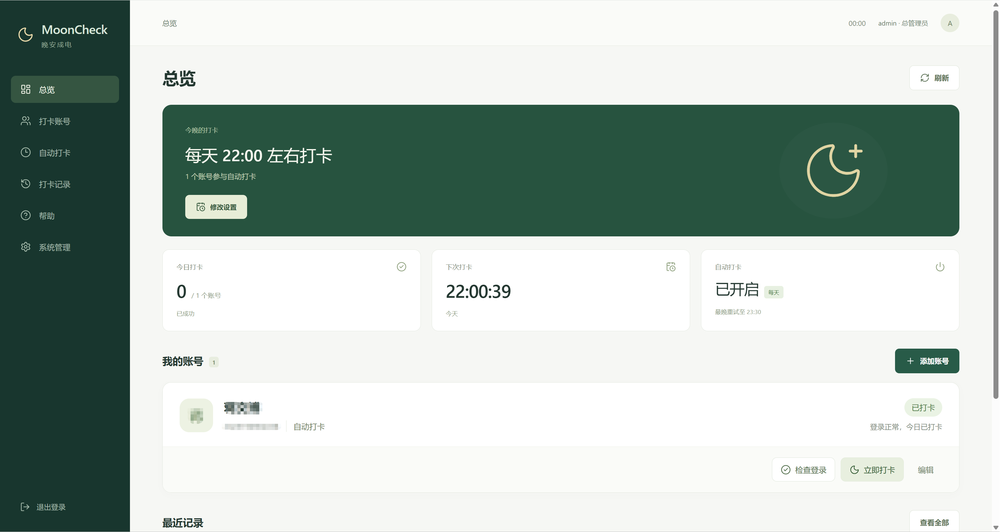
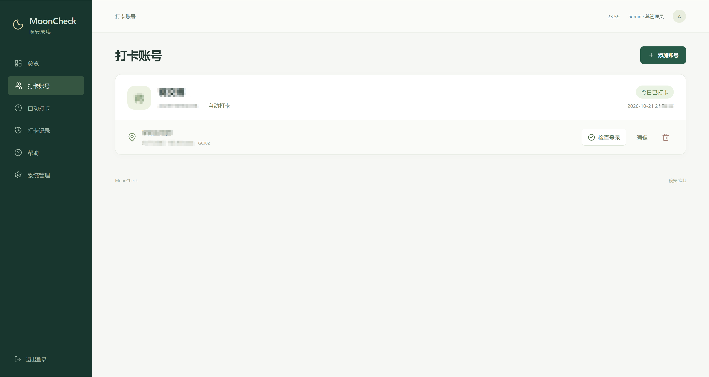
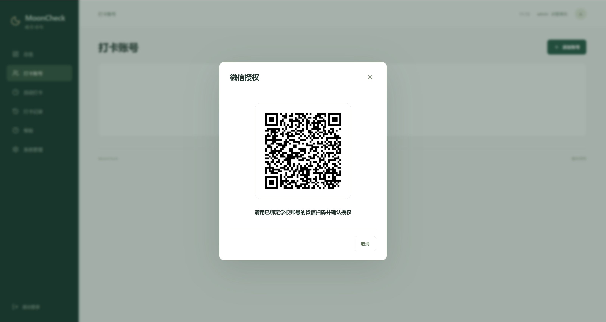
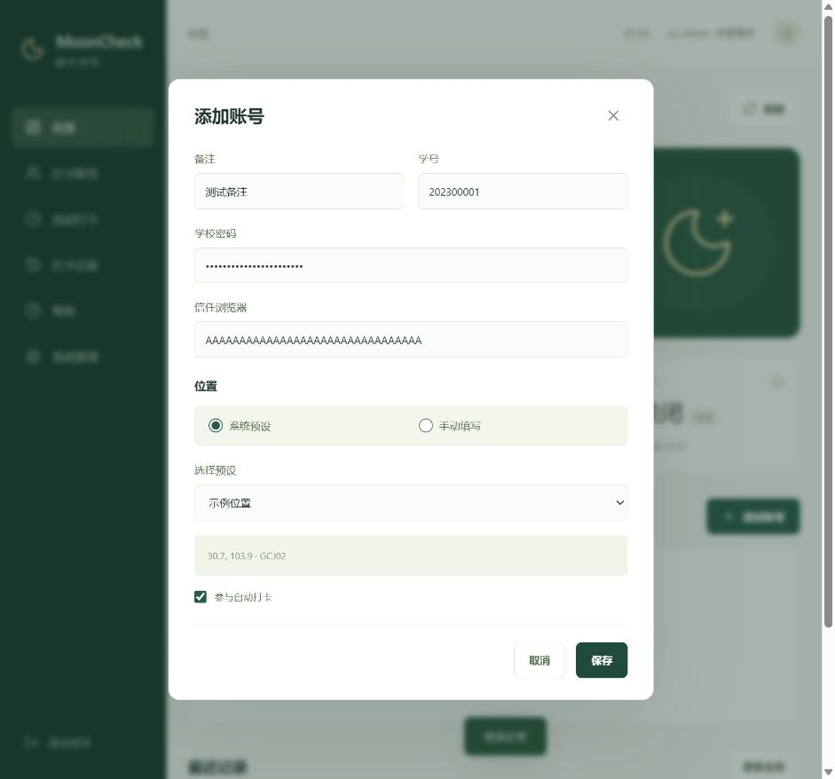
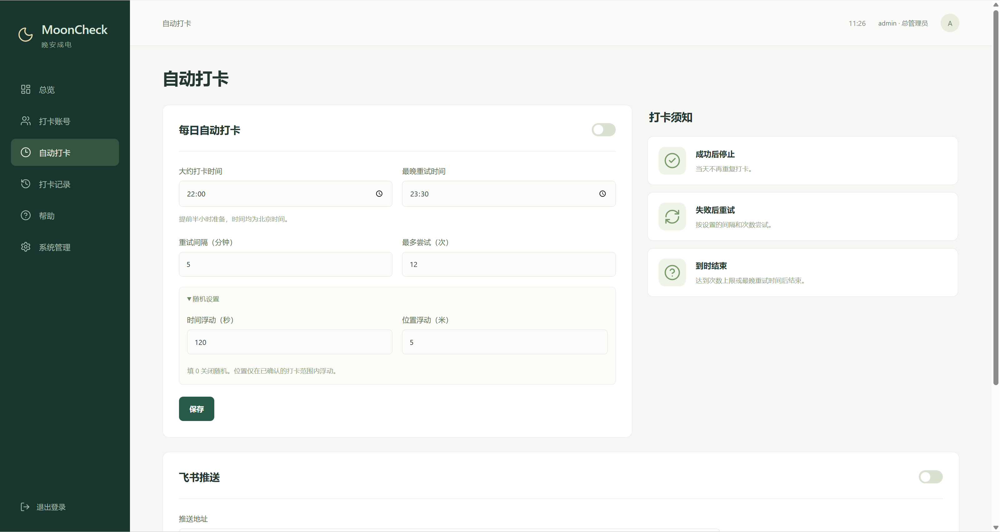
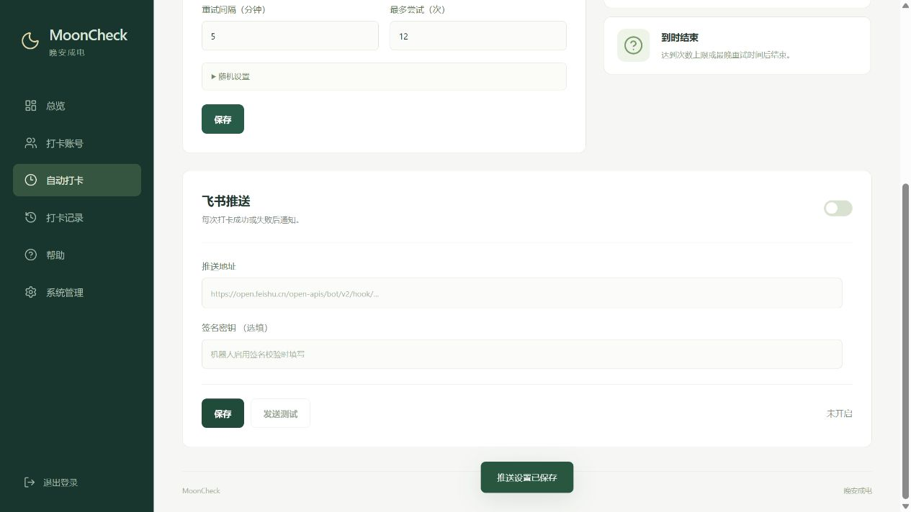
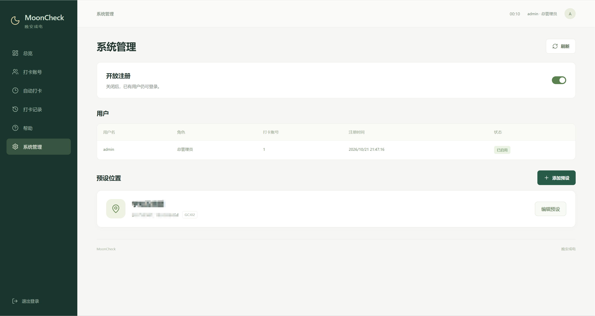
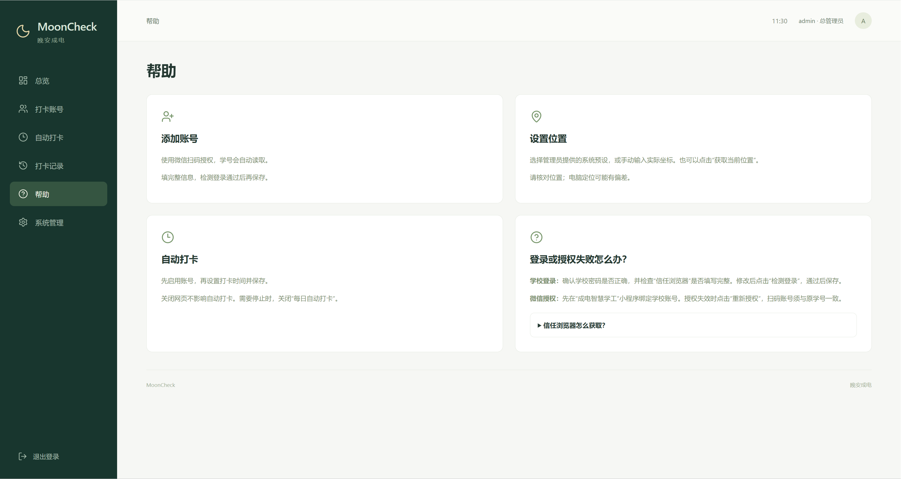

# UESTC-MoonCheck

适配 **2026 年 10 月 23 日后官方增加微信鉴权的新版打卡链路**。在原有学校统一身份认证基础上，加入微信扫码授权、小程序登录码获取及打卡操作票据验证，解决旧版链路无法直接提交打卡的问题。

## 免责声明

本项目为个人开发的非官方工具，与电子科技大学、微信及腾讯无隶属或合作关系。

请仅使用本人账号，在符合学校规定、实际位置与提交信息一致的前提下使用。不得用于冒用身份、虚假定位、代打卡或其他违规行为。

部署者应妥善保护账号信息、服务器及数据文件。使用本项目即表示理解上述说明，并自行承担使用及部署产生的责任。

## 项目简介

UESTC-MoonCheck 是一个使用 Python 开发、通过 Docker 部署的晚间打卡网站。

支持多用户注册、微信扫码授权、学校统一身份认证、定时打卡、失败重试和飞书机器人通知。

## 功能

- 多用户账号与总管理员。
- 每个用户可管理多个学校账号。
- 微信扫码读取学号，学号不可手动修改。
- 同时检查统一身份认证与微信授权。
- 管理员维护系统位置预设，也可手动填写坐标。
- 每日自动打卡、提前检查与失败重试。
- 可设置时间浮动和位置浮动。
- 微信凭据自动续期与失效提醒。
- 打卡记录查询、导出及详细错误说明。
- 每个用户独立配置飞书机器人。

## 界面预览

### 总览



### 打卡账号



### 微信授权



### 添加账号



### 自动打卡



### 飞书推送



### 系统管理



### 帮助



## 参考项目

**原始打卡链路**

- [UESTC-MoonCheck](https://github.com/richard297779/UESTC-MoonCheck)：学校统一身份认证、打卡接口及原始打卡链路的参考。

**微信授权与新版鉴权**

- [YYB-Go-Enhanced](https://github.com/525815266/YYB-Go-Enhanced)：应用宝协议、微信取码和凭据续期。
- [moon-uestc](https://github.com/MioYiSama/moon-uestc)：学校身份验证与打卡操作票据流程。
- [GoodnightUESTC](https://github.com/LCX-luo/GoodnightUESTC)：微信授权与学校账号验证的结合方式。

本项目使用 Python 实现相关流程，无需另外部署 Go 服务。

## 部署要求

- Linux 服务器。
- 已安装 Docker Engine 和 Docker Compose 插件。
- 服务器能访问镜像仓库、Python 包源、学校平台及微信、应用宝授权服务。
- 使用域名部署时，域名需解析到服务器，并放行 TCP 80、443 端口。

检查 Docker 是否可用：

```bash
docker --version
docker compose version
```

以下命令应在包含 `compose.yaml` 和 `mooncheck.sh` 的项目目录中执行。

## Docker 部署

### 启动

上传源码并解压，进入项目目录：

```bash
cd MoonCheck-Docker
sudo bash mooncheck.sh start
```

首次启动会生成 `.env`、构建镜像，并显示首次设置令牌。

### 使用域名

根据提示输入域名，例如：

```text
checkin.example.com
```

不要填写 `https://`、端口或路径。

启动后访问：

```text
https://checkin.example.com
```

网站入口会自动申请和续期 HTTPS 证书。请确认域名解析正确，且服务器的 80、443 端口未被其他服务占用。

### 暂无域名

在域名提示处直接回车，服务默认只监听服务器的 `127.0.0.1:8080`。

在自己电脑的终端执行：

```bash
ssh -N -L 8080:127.0.0.1:8080 用户名@服务器公网IP
```

保持终端连接，在浏览器打开：

```text
http://localhost:8080
```

### 使用公网 IP 临时访问

先按“暂无域名”启动，再编辑项目目录中的 `.env`，修改以下配置：

```dotenv
DOMAIN=你的服务器公网IP
SITE_ADDRESS=http://你的服务器公网IP
BIND_IP=0.0.0.0
HTTP_PORT=8080
SECURE_COOKIE=0
```

保留原有 `SETUP_TOKEN` 和其他配置，然后执行：

```bash
sudo docker compose up -d
```

在云服务器防火墙或安全组中放行 TCP 8080，访问：

```text
http://你的服务器公网IP:8080
```

公网 HTTP 适合临时测试，正式使用建议配置域名和 HTTPS。

## 首次使用

### 创建管理员

首次打开网站时，使用启动脚本显示的设置令牌创建总管理员。

设置令牌保存在 `.env` 的 `SETUP_TOKEN` 中，只用于首次创建管理员。之后使用网站用户名和密码登录。

### 用户注册

管理员可以在“系统管理”中控制是否开放注册，并启用或停用用户。

用户注册的是网站账号；学校账号在登录网站后单独添加。不同用户的学校账号、打卡设置、记录和飞书配置分别保存。

### 添加学校账号

1. 先在“成电智慧学工”官方小程序中绑定本人的学校账号。
2. 点击“添加账号”，使用已绑定学校账号的微信扫码并确认授权。
3. 填写备注、学校密码、信任浏览器和位置。
4. 点击“检测登录”。
5. 检测通过后，按钮变为“保存”，再次点击才正式添加账号。

扫码完成后只生成临时草稿，不会直接添加账号。学号从微信绑定信息读取，不能自行修改。

扫码草稿有效期为 20 分钟，检测结果有效期为 5 分钟。关闭添加窗口或重启服务后，需要重新扫码。

### 信任浏览器

填写学校统一身份认证使用的 32 位浏览器指纹。

可在已完成学校统一身份认证的浏览器中，查看 `idas.uestc.edu.cn` 站点下名为 `MULTIFACTOR_BROWSER_FINGERPRINT` 的 Cookie，复制其值。

请勿将学校密码或信任浏览器信息公开分享。

### 设置位置

位置有两种方式：

- **系统预设**：选择管理员添加的位置。
- **手动填写**：输入实际经纬度、坐标系和定位精度，也可使用“获取当前位置”。

位置描述由学校接口获取，无需手动填写。

浏览器定位通常需要 HTTPS 或 localhost，获取后请核对坐标。管理员修改预设后，使用该预设的账号会采用更新后的坐标。

### 检查状态

点击“检查状态”，同时验证统一身份认证和微信授权，并查询当天打卡记录，不提交打卡。

两项均正常时，记录显示：

```text
状态正常

统一身份认证正常，微信授权正常
```

如果当天已经打卡，说明中还会注明“今日已打卡”。

### 编辑与重新授权

只修改备注、位置或是否参与自动打卡时，可以直接保存。

修改学校密码、信任浏览器后，需要重新检测登录再保存。

微信授权失效，或访问凭据异常且自动刷新未恢复时，显示“重新授权”。重新扫码必须与原学校账号的学号一致，否则拒绝保存。

## 自动打卡

在“自动打卡”页面开启“每日自动打卡”，同时确认需要执行的学校账号已勾选“参与自动打卡”。

所有时间均使用北京时间。

### 设置项

| 设置 | 说明 |
| --- | --- |
| 大约打卡时间 | 当天计划打卡的基准时间 |
| 最晚重试时间 | 到达该时间后，不再发起新的自动提交 |
| 重试间隔 | 两次正式尝试之间的基础间隔 |
| 最多尝试 | 包含首次执行在内的正式尝试次数 |
| 时间浮动 | 在基准时间之后增加随机延迟，填 0 关闭 |
| 位置浮动 | 在设置的米数范围内浮动，填 0 关闭 |

例如设置大约 22:00 打卡、时间浮动 120 秒，实际计划会安排在 22:00～22:02 之间。

每个账号每天分别生成计划，服务重启不会重新随机当天时间。

位置浮动仅在能够确认学校允许范围时启用，不会自动把范围外的位置移动到允许范围内。

### 提前检查

从当天实际计划打卡时间的前半小时开始检查状态：

- 检查统一身份认证、微信授权和当日记录。
- 不提交打卡。
- 失败后间隔 2 分钟再试。
- 最多尝试 3 次，包含首次。
- 成功后结束本轮提前检查。
- 到达正式打卡时间后，不再继续本轮提前检查。

提前检查使用单独的次数和间隔，不占正式打卡次数。提前检查失败不会暂停当天任务。

### 手动打卡

点击“立即打卡”只执行一次，失败后不会自动重试，也不占用或改变自动打卡的重试次数和间隔。主页“下次打卡”只显示自动任务的计划。手动打卡成功后，当天自动任务不再重复提交。

### 正式执行与重试

到达计划时间后，系统先验证身份并查询当天记录。

当天已经打卡时，不重复提交；尚未打卡时，检查学校允许时段，获取本次操作票据和位置描述，再提交并查询结果。

失败后按设置的间隔、次数和最晚重试时间继续尝试。开启时间浮动时，重试间隔还会增加最多 30 秒的随机延迟。

每次重试都先查询当天记录，避免上一轮已被学校接收却重复提交。

确认成功后，当天不再自动提交。第二天重新生成计划、计算次数，历史记录保留。

关闭网页不影响自动打卡，运行服务的电脑或服务器需要保持开机联网。

## 打卡记录

记录包含执行时间、账号、操作、结果和说明，可导出为 CSV。

发生错误时，会记录能够获取到的失败环节、平台提示、业务码和 HTTP 状态。例如：

- 学校统一身份认证失败。
- 微信凭据刷新失败。
- 微信登录码获取失败。
- 打卡票据获取失败。
- 学校平台拒绝提交。
- 提交后查询结果失败，结果待确认。

记录不会保存完整请求或响应，也不会显示密码、Cookie、微信登录码和操作票据。

## 飞书机器人

每个用户可在“自动打卡 → 飞书推送”中单独配置，默认关闭。

### 配置

1. 在飞书群中添加自定义机器人。
2. 复制机器人的 Webhook 地址。
3. 在网站开启飞书推送，填写地址并保存。
4. 如果机器人启用了签名校验，填写对应签名密钥。
5. 点击“发送测试”，确认机器人能够收到消息。

### 通知范围

| 场景 | 通知方式 |
| --- | --- |
| 正式打卡成功 | 当次执行后推送 |
| 正式任务发现今日已打卡 | 确认后推送 |
| 正式打卡失败或结果待确认 | 每次执行后推送，包含自动重试 |
| 提前检查成功 | 成功后推送一次 |
| 提前检查三次均失败 | 第三次失败后推送一次 |
| 微信后台续期失败或授权失效 | 首次异常、状态变化时推送；相同状态每 6 小时提醒一次 |
| 微信后台续期恢复 | 恢复后推送一次 |
| 手动检查状态 | 不推送 |

失败通知使用与记录相同的详细原因。

飞书发送失败不会改变学校打卡结果，也不会阻止下一次重试。关闭推送不会关闭自动打卡。

## 学知组团坐标参考

以下坐标仅供核对，请确认与本人实际位置及所用坐标系一致。

| 地点 | 经度 | 纬度 |
| --- | --- | --- |
| 学知一组团 | 103.932037 | 30.754670 |
| 学知二组团 | 103.932328 | 30.753780 |
| 学知三组团 | 103.933849 | 30.754874 |
| 学知四组团 | 103.934154 | 30.753768 |
| 学知五组团 | 103.935437 | 30.753607 |
| 学知六组团 | 103.931652 | 30.755699 |
| 学知七组团 | 103.932501 | 30.756534 |
| 学知八组团 | 103.932875 | 30.755637 |

## 常用命令

在项目目录执行：

```bash
# 启动
sudo bash mooncheck.sh start

# 查看运行状态
sudo bash mooncheck.sh status

# 查看日志
sudo bash mooncheck.sh logs

# 重启
sudo bash mooncheck.sh restart

# 停止
sudo bash mooncheck.sh stop

# 更新源码后重新构建
sudo bash mooncheck.sh update
```

## 更新与迁移

更新时替换程序文件，保留原有 `.env` 和完整的 `data/` 目录，再执行：

```bash
sudo bash mooncheck.sh update
```

迁移服务器时，将项目、`.env` 和完整的 `data/` 目录一并迁移，并停止旧服务器上的服务，避免两边同时执行任务。

`data/master.key` 是读取加密账号信息所需的密钥，必须与数据库一起保存。不要将 `.env`、`data/` 或包含这些文件的压缩包上传到公开仓库。

本版本面向全新部署，不提供早期版本的数据库迁移转换。

## 常见问题

### 提示 `no configuration file provided`

当前目录没有 Compose 配置文件。先进入包含 `compose.yaml` 的项目目录，再执行命令。

### 容器已启动，但网页无法访问

检查访问方式与配置是否一致：

- 默认配置只允许通过 localhost 或 SSH 转发访问。
- 公网访问需要配置监听地址、正确端口和云服务器防火墙。
- 域名 HTTPS 需要正确的 DNS 解析和可用的 80、443 端口。

查看运行状态和日志：

```bash
sudo bash mooncheck.sh status
sudo bash mooncheck.sh logs
```

### 网站关闭后还会自动打卡吗？

会。自动任务在服务端运行，不依赖浏览器保持打开。

### 为什么还需要学校密码和微信授权？

两者是当前打卡链路的必要环节。系统需要验证统一身份认证，并通过微信获取本次打卡所需的授权票据。

### 为什么设置了打卡时间，却没有成功？

查看当天记录中的具体原因，并确认自动打卡开关、账号参与状态、最多尝试次数、最晚重试时间及学校允许时段。

网站设置的时间不会改变学校平台允许的打卡时段。

### 微信授权为什么又要求扫码？

短期凭据到期可以尝试自动续期；刷新凭据被明确拒绝、授权被撤销或缺少必要凭据时，需要本人重新扫码。重新授权的学号必须与原账号一致。
