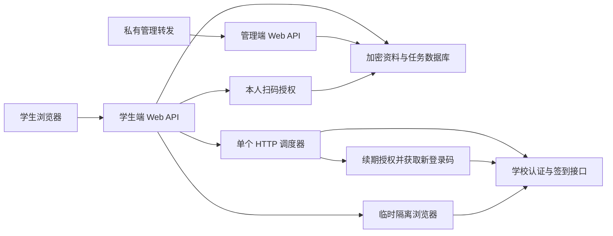

# 系统设计

## 登录与身份

学生只使用学校身份，运营者使用独立管理账号。学校验证完成后，学生用户与唯一学号绑定。Cookie、密码和设备资料加密存储；账号权限、Origin 和 CSRF 在写请求时校验。

helper 提供原校方 DOM/CSS 的被动文档，实际学校 JavaScript 留在服务器的隔离浏览器中。本人操作验证码或二次验证，服务器独立验证身份后保存凭据。helper 最多同时处理两个交互会话；日常任务复用 HTTP 会话，不创建浏览器。

可选微信授权模块使用应用宝 OAuth 和 Python 登录码协议，固定访问学校小程序。授权完成前核对学校身份，并确认能取得真实操作票据；刷新令牌、访问令牌和授权标识保存在账户密文中，登录码、小程序会话和票据只在内存使用。已完成的授权独立于网站会话，跨天、重启时按需续期。撤销同时取消未完成扫码；扫码完成事务核对授权版本，旧流程不能覆盖后来的撤销或重新绑定。

## 每日调度

每天为账号分配偏好时间前后 5 分钟内的空闲分钟，使用该分钟前 30 秒发起；秒级偏移为 0–19 秒。当天分配持久化，日期或偏好变化时重新计算。主任务截止通常早于全局截止约 5 分钟，留出恢复时间。

同一偏好最多提供 11 个主分钟窗口，窗口边缘和校方时段可能减少容量。窗口满时显示调整提示，不跨出偏好范围；全局正常主窗口最多 134 个。单 worker 串行执行，任务间至少间隔 20 秒，网络耗时会影响能否及时发起。

临时网络或会话错误可在至少 120 秒后进入一次延后重试，使用分钟后半段。需要本人参与的验证码、MFA 或密码拒绝会停止后台重登并提示更新认证。重新验证只解除该账号的限制。

## 每日一次与结果确认

读取当日学校记录后才决定是否提交；提交前先保存持久 claim。进程重启、网络超时或结果不明时复查同一条学校记录，不再发送第二次提交。学校已存在的签到、报备或豁免记录直接展示。

首次经学校确认的手动签到用于开启每日计划。已失败的当日自动任务不会在用户更新认证后静默创建第二个任务；用户可在开放时段明确手动处理。

## 前端和数据

前端由明确状态驱动首页操作，首次使用才展示三步引导，正常自动计划展示预计时间。浅深色统一使用语义色板。托管说明从同一接口读取。

历史列表按北京时间自然日过滤并使用 `(created_at,id)` 游标分页，所有页重新按当前账号授权过滤。页面展开不改变数据库历史。
